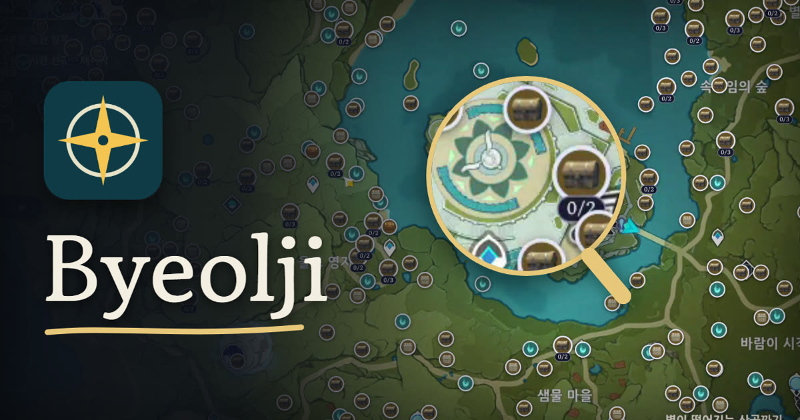

  

<h1 align="center">Byeolji (별지) · 원신 지도 오버레이</h1>

  원신 PC <b>큰 지도와 미니맵 위에 자원 위치를 바로 띄워 주는</b> 무료 Windows 프로그램입니다. 
  자원 찾을 때마다 게임 밖 지도 사이트로 나갔다 올 필요가 없어요.

  <a href="https://github.com/juan-hong/Byeolji/releases/latest"><b>⬇ 최신 버전 받기</b></a> ·
  <a href="https://byeolji.app">사이트</a> ·
  <a href="https://ko-fi.com/byeolji">Ko-fi</a> ·
  <a href="#english">English</a> ·
  <a href="#日本語">日本語</a> ·
  <a href="#中文">中文</a>

## 기능

- **큰 지도**: 지도(M)를 열고 끌거나 확대해도 고른 자원 마커가 따라옵니다. 지하 층도 지원합니다.
- **미니맵**: 걸어 다닐 때 미니맵 원 안에도 가까운 자원이 뜹니다.
- **획득 표시**: 마커를 Ctrl+클릭하면 흐리게 표시됩니다(키는 설정에서 바꿀 수 있음). 로그인하면 여러 PC에서 기록이 맞춰집니다(로그인은 선택).
- 최신 스네즈나야 지역까지 **모든 지역**, 공식 지도 데이터.
- **패드(컨트롤러)** 조작, **16:9 · 16:10 · 4:3 · 21:9 · 32:9 · 4K** 화면 지원.
- **7개 언어**: 한국어, English, 日本語, 中文, Русский, Bahasa Indonesia, Español.

## 단축키

| 키 | 하는 일 |
|---|---|
| F6 | 지도 마커 켜기·끄기 |
| F7 | 자원 고르는 패널 열기·닫기 |
| F8 | 위치 다시 찾기 |
| F10 | 진단 화면 |

## 설치

1. [릴리스](https://github.com/juan-hong/Byeolji/releases/latest)에서 `Byeolji.Setup.x.y.z.exe`를 받습니다 (Windows 10/11, 64비트).
2. 코드 서명이 아직 없어서 크롬이나 Windows가 경고를 띄웁니다. **유지** / **추가 정보 → 실행**을 누르면 됩니다. 그림으로 된 안내: [byeolji.app](https://byeolji.app/?lang=ko#install)
3. 관리자 권한을 허용합니다. 원신이 관리자 권한으로 돌아가서, 같은 권한이어야 게임 위에서 단축키가 먹힙니다.

설치 파일은 이 페이지나 [byeolji.app](https://byeolji.app)에서만 받아 주세요.

## 어떻게 동작하나요

게임 화면을 **내 PC 안에서만** 읽어 지도가 어디를 보여 주는지 알아낸 뒤, 투명한 창에 마커를 그립니다.
게임 메모리나 파일을 읽거나 고치지 않고, 게임에 아무것도 끼워 넣지 않습니다. 화면 캡처는 어디로도 보내지 않습니다.

## 문의

버그나 건의: support@byeolji.app

---

## English

Free Windows overlay that shows Genshin Impact resource locations **right on the in-game map and minimap** (PC). No more alt-tabbing to an interactive map.

- Big map with underground layers, minimap markers, Ctrl+click to mark as collected (optional cloud sync).
- All regions incl. the latest Snezhnaya area. Controller play and 16:10 / 4:3 / ultrawide / 4K screens supported.
- Hotkeys: F6 markers on/off, F7 panel, F8 relocate, F10 diagnostics.
- [Download](https://github.com/juan-hong/Byeolji/releases/latest) · [Website](https://byeolji.app/?lang=en). SmartScreen may warn because the installer isn't code-signed yet: **More info → Run anyway**.
- Reads the screen locally only. No memory reading, no injection, nothing sent anywhere.

## 日本語

原神PC版の大きな地図とミニマップの上に素材の場所を直接表示する無料オーバーレイです。[最新版をダウンロード](https://github.com/juan-hong/Byeolji/releases/latest) · [サイト](https://byeolji.app/?lang=ja)

## 中文

在原神PC版大地图和小地图上直接显示资源位置的免费叠加层工具。[下载最新版](https://github.com/juan-hong/Byeolji/releases/latest) · [官网](https://byeolji.app/?lang=zh)

---

### 저장소 구성

이 저장소는 설치 파일 [릴리스](https://github.com/juan-hong/Byeolji/releases)와 사이트 [byeolji.app](https://byeolji.app)의 파일(`index.html`, `i18n.js`, `site.js`, `site.css`)을 함께 둡니다. `main`에 push하면 Cloudflare가 사이트를 자동 배포합니다.

Byeolji는 비공식 팬 도구이며 HoYoverse와 관련이 없습니다. 원신과 지도 데이터의 권리는 HoYoverse에 있습니다.
